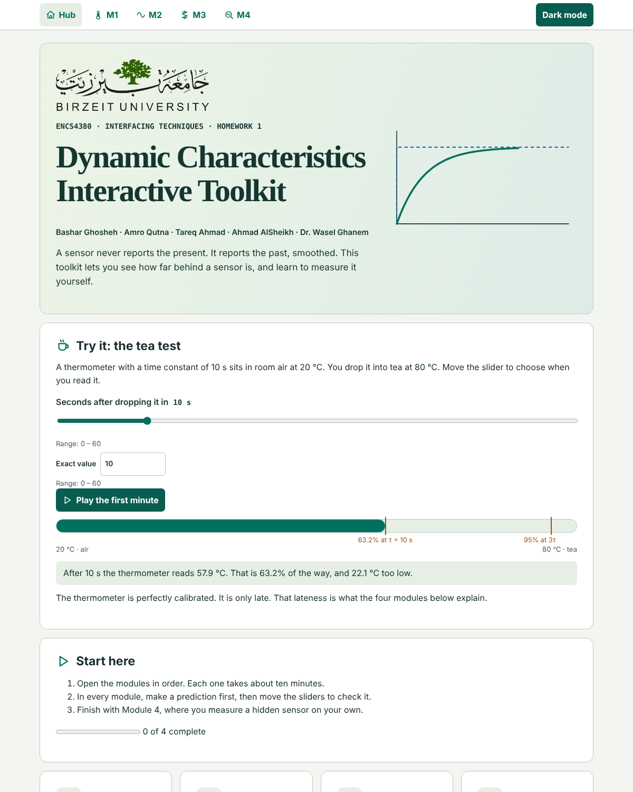
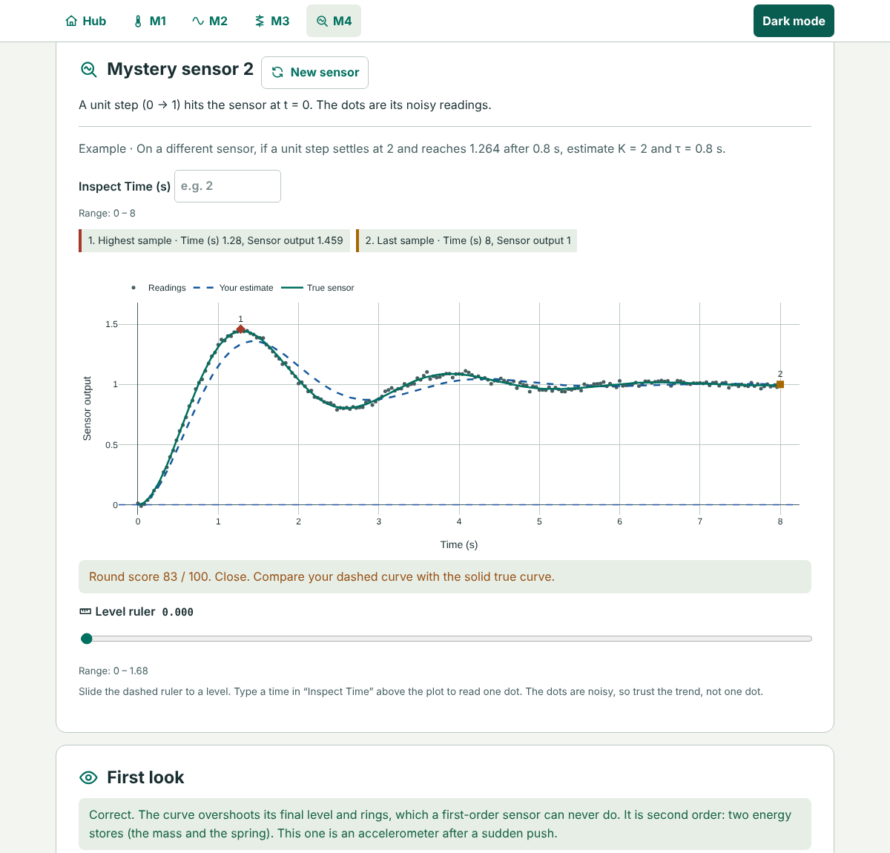
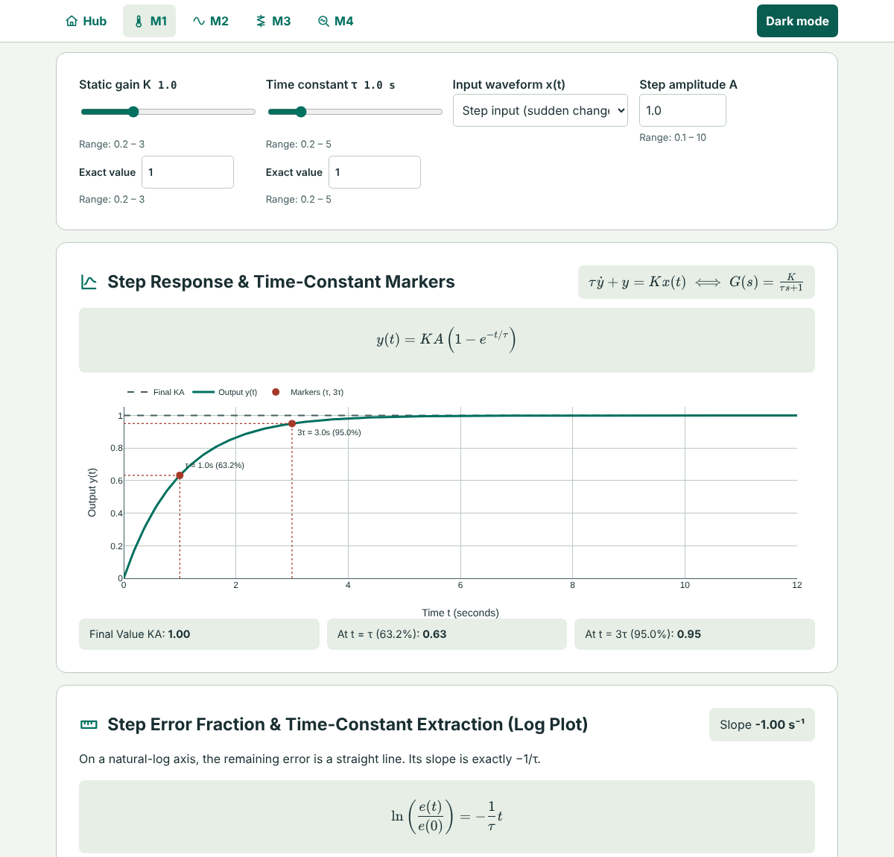
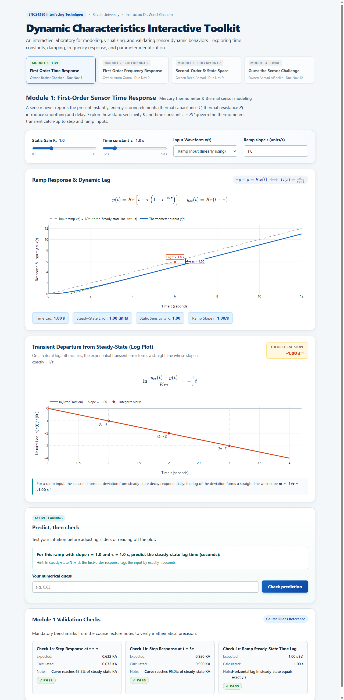
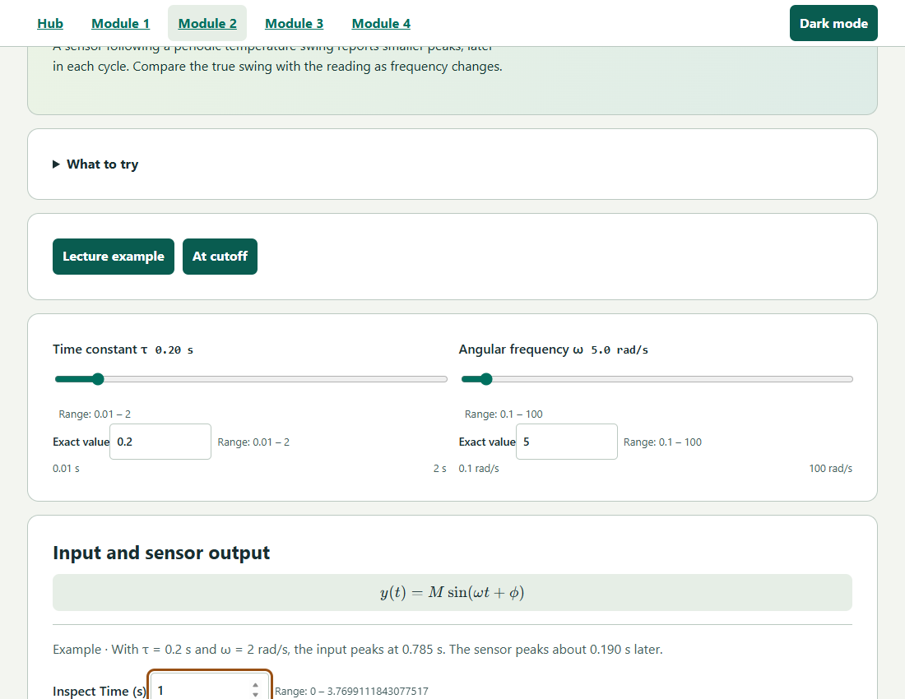
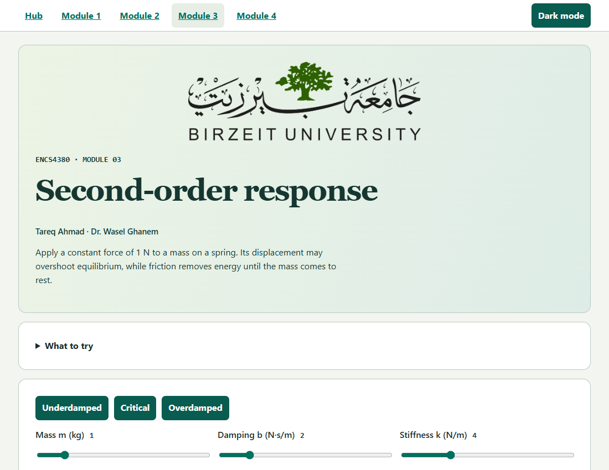
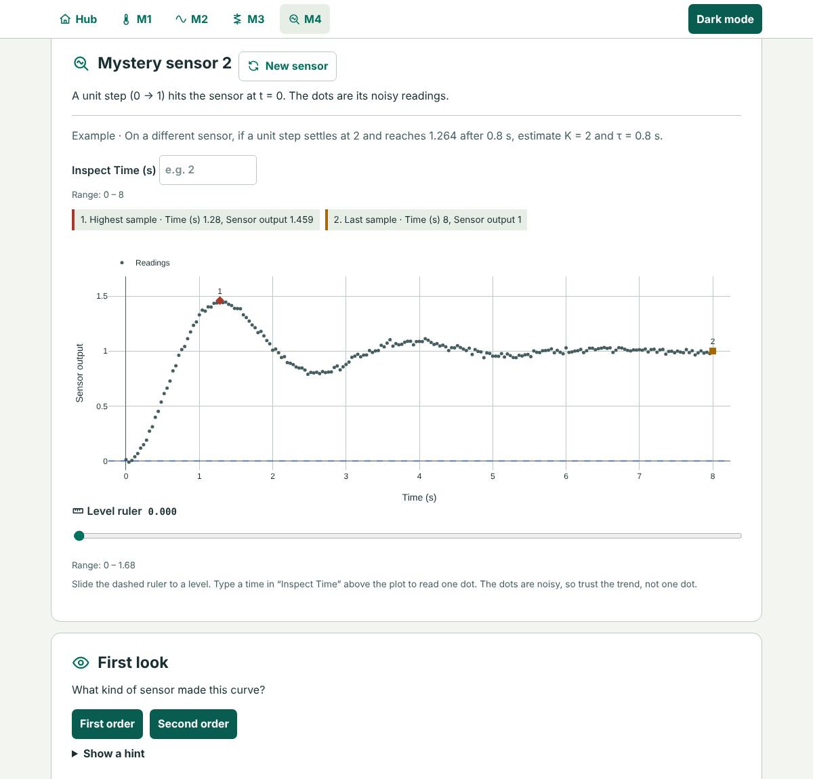
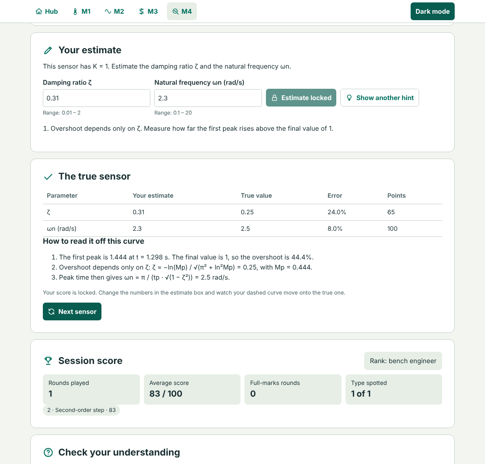

# Dynamic Characteristics Interactive Toolkit

Interactive web toolkit for sensor dynamic characteristics, built for **ENCS4380 Interfacing Techniques** at Birzeit University (Homework 1).

- **Live site:** [https://bashar-ghosheh.github.io/](https://bashar-ghosheh.github.io/)
- **Instructor:** Dr. Wasel Ghanem

A sensor never reports the present. It reports the past, smoothed. The toolkit makes that visible in four modules, and every plot runs live in the page.



---

## Team members and who built what

| Member | Module | Page | Status |
| :--- | :--- | :--- | :--- |
| **Bashar Ghosheh** | Module 1: First-order time response | `module1.html` | Completed |
| **Amro Qutna** | Module 2: First-order frequency response | `module2.html` | Completed |
| **Tareq Ahmad** | Module 3: Second-order response and state space | `module3.html` | Completed |
| **Ahmad AlSheikh** | Module 4: Guess the sensor, hub page and final integration | `module4.html`, `index.html` | Completed |

---

## Hub (`index.html`)

- The "tea test": a live version of the thermometer example from the homework sheet (20 °C air into 80 °C tea, τ = 10 s).
- Cards for the four modules, with progress saved in the browser.
- K, τ, ζ and ωn explained in plain words.
- Download buttons for the lecture slides and the State-Space Modeling notes.
- All **six validation checks** on one board, recalculated in the browser with the modules' own code, each with expected value, calculated value and PASS or FAIL.

## Module 1: First-order time response

Built by **Bashar Ghosheh**. Models a first-order sensor such as a mercury thermometer:

$$\tau \dot{y} + y = K x(t) \iff G(s) = \frac{K}{\tau s + 1}$$

- **Controls:** gain $K$, time constant $\tau$, input waveform (step or ramp) and input size.
- **Step response:** $y(t) = KA(1 - e^{-t/\tau})$ with the final line $KA$ and markers at $\tau$ (63.2%) and $3\tau$ (95.0%).
- **Ramp response:** $y(t) = Kr[t - \tau(1 - e^{-t/\tau})]$ with the time lag $\tau$ and the steady-state error $Kr\tau$.
- **Log error plot:** $\ln(e(t)/e(0)) = -t/\tau$, a straight line with slope $-1/\tau$.
- **Predict, then check**, a quiz, and validation check 1.

## Module 2: First-order frequency response

Built by **Amro Qutna**. A first-order sensor driven by a sine wave:

$$M = \frac{1}{\sqrt{1 + (\omega\tau)^2}}, \qquad \phi = -\tan^{-1}(\omega\tau)$$

- Sliders for $\tau$ and the input frequency $\omega$, with the input and output sines on one plot.
- Amplitude ratio, phase lag and dynamic error $\delta = M - 1$.
- Bode magnitude and phase plots with the cutoff at $\omega = 1/\tau$.
- Predict, then check, a quiz, and validation checks 2 and 3.
- Bonus: superposition of two sines, to see how the sensor distorts a mixed signal.

## Module 3: Second-order response and state space

Built by **Tareq Ahmad**. The mass-spring-damper model is `m*x'' + b*x' + k*x = F(t)` with a 1 N step input. Its transfer function is `G(s) = 1/(m*s^2 + b*s + k)`, natural frequency `sqrt(k/m)` and damping ratio `b/(2*sqrt(m*k))`.

- Live mass, damping and stiffness controls, plus underdamped, critical and overdamped presets.
- Closed-form displacement with measured 10–90% rise time, peak time, overshoot and 2% settling time.
- Live state-space matrices A and B, transfer poles next to the eigenvalues of A, and the phase plane.
- Predict, then check, a quiz, and validation checks 4 to 6.

## Module 4: Guess the sensor

Built by **Ahmad AlSheikh**. The page puts a hidden sensor on a "test bench" and shows one noisy response. The user reads the curve and works backwards.

There are three kinds of round, picked at random:

| Round | Hidden sensor | The user estimates | Lecture method |
| :--- | :--- | :--- | :--- |
| First-order step | random $K$ and $\tau$ | $K$ and $\tau$ | final level, 63.2% point, or the log method |
| First-order sine | random $\tau$, stated $\omega$, $K = 1$ | $\tau$ | amplitude ratio $M$, cross-check with the phase lag |
| Second-order step | random $\zeta$ and $\omega_n$, $K = 1$ | $\zeta$ and $\omega_n$ | overshoot and peak time |

- **First look:** before estimating, the user decides if the curve is first order or second order, and learns which energy stores explain the answer.
- **Measuring tools:** a level ruler (dashed line), a time inspector that reads one sample, and a log view that plots $\ln(1 - y/K)$ for the log method.
- **Hints on request:** three steps per round, from a nudge ("Overshoot depends only on ζ") to the full formula with a small lookup table.
- **Reveal:** the true curve is drawn over the user's curve, with a table of estimate, true value, error and points, and a worked solution for that exact curve.
- **Score:** an estimate within 10% of the true value earns 100 points. Beyond that it loses 2.5 points per extra percent, so 30% error earns 50 and 50% earns 0. The round score is the average of the estimates.
- **Session score:** rounds played, average, full-marks rounds and a rank, plus a "New sensor" button.
- After the reveal the score is locked, but the user can keep changing the numbers and watch the dashed curve move onto the true one.



---

## Validation checks

| # | Check | Expected |
| :--- | :--- | :--- |
| 1 | First-order step | $y(\tau) = 0.632\,KA$, $y(3\tau) = 0.95\,KA$ |
| 2 | $\tau = 0.2$ s, input $\sin 2t$ | amplitude 0.93, lag 21.8° |
| 3 | 100 Hz with at most 5% dynamic error | $\tau_{max} \approx 0.52$ ms, lag 9.3° at 50 Hz |
| 4 | Second order, $\zeta = 0.5$ | overshoot 16.3% |
| 5 | Second order, $\zeta = 1$ | no overshoot |
| 6 | State space, $m = 1$, $b = 2$, $k = 4$ | eigenvalues $-1 \pm j1.732$, equal to the poles |

All six are shown on the hub page, and again inside the module they belong to.

## Screenshots

### Module 1: step and ramp



### Module 2: frequency response


### Module 3: second-order response


### Module 4: the bench and the score



---

## Files

| File | What it does |
| :--- | :--- |
| `index.html`, `hub.js` | Hub page, tea test and the validation board |
| `module1.html`, `app.js` | Module 1 |
| `module2.html`, `module2.js`, `frequency.js` | Module 2 page and its formulas |
| `module3.html`, `module3.js`, `second-order.js` | Module 3 page and its formulas |
| `module4.html`, `module4.js`, `sensor-game.js` | Module 4 page and its game maths |
| `module-assets/` | Shared theme, icons, plot helper, graph reader and quiz |
| `resources/` | Lecture slides and State-Space notes, offered for download on the hub |
| `*.test.js` | Numerical tests |

## How to run

1. **Online:** open the live link: [https://bashar-ghosheh.github.io/](https://bashar-ghosheh.github.io/)
2. **Locally:** clone the repository and open `index.html` in any modern browser. Plotly and KaTeX load from CDNs, so an internet connection is needed.

Run the numerical tests from the repository root (Node 18 or newer):

```sh
node --test frequency.test.js second-order.test.js sensor-game.test.js notes-check.test.js
```

`notes-check.test.js` compares every closed-form formula in the toolkit with the RK4 simulator and the `eig2` function from Section 7.1 of the State-Space Modeling notes. The Module 4 test also plays 1200 random rounds as a "careful student" using the lecture methods, to confirm the game is fair.

---

## AI assistant disclosure

In accordance with the course guidelines (Section 8):

- **Module 1:** AI tools helped structure the HTML/CSS layout, set up the Plotly chart configuration and run browser tests. All formulas were reviewed against the course material.
- **Module 2:** Codex assisted with implementation, packaging and verification. Amro Qutna is responsible for reviewing and explaining the module's code and equations.
- **Module 3:** Codex assisted with implementation, packaging, numerical verification and repository integration. Tareq Ahmad is responsible for reviewing and explaining the module's code and equations.
- **Module 4, hub and integration:** Claude assisted with the implementation of Module 4 and the hub page, moving Module 1 to the shared theme, browser testing and this README. Ahmad AlSheikh is responsible for reviewing and explaining the module's code and equations.
